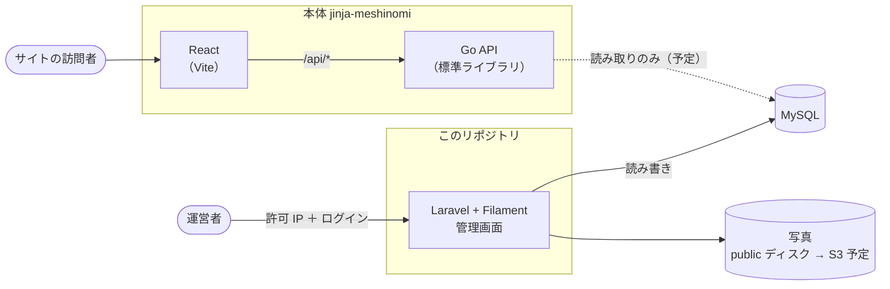
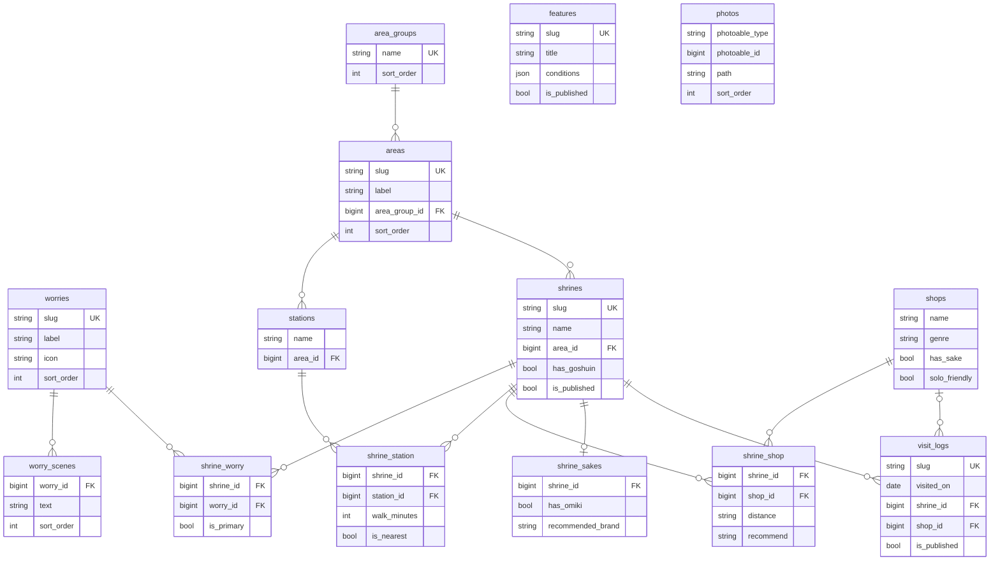

# 神社めし呑み 社務所（jinja-meshinomi-admin）

[](https://github.com/takaharu-dev/jinja-meshinomi-admin/actions/workflows/ci.yml)

神社と、参拝後に寄りたいごはん・地酒のお店を紹介するサイト「神社めし呑み」の管理画面です。神社・お店・特集・参拝記録などを登録し、MySQL に保存します。

- 本体サイト：[takaharu-dev/jinja-meshinomi](https://github.com/takaharu-dev/jinja-meshinomi)（React + TypeScript / Go）
- この管理画面：Laravel 13 + Filament 5 / MySQL 8.4

本体は今、データを Go のコード（`backend/data.go` など）に直接書いています。この管理画面で DB にデータを登録し、あとで本体の Go API が同じ DB を直接読む形に切り替える予定です。

> [!NOTE]
> 開発中です。進み具合は [issues](https://github.com/takaharu-dev/jinja-meshinomi-admin/issues) を見てください。下の構成やテーブルには、まだ作っていないもの（予定）も含みます。

## 構成



- 書き込むのは管理画面だけ。Go API は読むだけにして、書き込みの経路を1つにする
- テーブルの定義（マイグレーション）はこのリポジトリが持つ

## 画面

左のメニューは「何をしたいか」で3つに分けている。

| グループ | 項目 | できること |
|---|---|---|
| ＋ 登録する | 神社を登録・参拝記録を書く・お店を登録 | よく使う登録画面への近道 |
| 一覧を見る | 神社 | 基本情報・紹介文・地酒・公開の編集。編集画面の下のタブで悩み（メイン）・最寄り駅（徒歩分数・最寄り）・参拝後のお店（距離・おすすめ）・写真を紐づける。一覧の上のタブで「公開中」「非公開」「写真がない」に絞れる |
| | 参拝記録 | 参拝した日・神社・寄ったお店・本文（段落は空行区切り）。写真 |
| | お店 | 店名・ジャンル・予算・日本酒・一人でも入りやすいか。写真 |
| | 特集 | タイトル（件数を入れられる）・導入文と、並べる神社の条件（悩み・エリア・こだわり・キーワード） |
| 設定（ふだんは触らない） | 悩み・エリアグループ・エリア・駅 | 表示名・スラッグ・並び順など。最初に整えたら、ふだんは触らない |

- ホーム（ダッシュボード）には「使い方」として、登録の順番（下準備 → 神社とお店 → 記事）と、各画面の件数・「一覧を見る」「登録する」ボタンを出す
- メニューには件数を出し、一覧の見出しは「神社の一覧」、右上のボタンは「神社を登録」のように、何の画面で何ができるかを言葉で示す
- データがまだない一覧には「まだ登録されていません／右上のボタンから追加できます。」と出す
- 写真の画面は神社・お店・参拝記録で共通。保存先は `ADMIN_PHOTO_DISK` で切り替える
- ほかのデータで使われているもの（参拝記録がある神社、神社に紐づいているお店など）は消せず、通知で理由を出す

## 設計判断

### 管理画面を別リポジトリにした

- 本体（React / Go）と言語もデプロイ先も違うので、リポジトリを分けた方がそれぞれの CI・依存関係・リリースが単純になる
- 管理画面は運営者しか使わないので、公開サイトと一緒にデプロイする必要がない。管理画面を止めても公開サイトは動き続ける
- 管理画面は CRUD 画面・ログイン・ファイルアップロードが中心で、Laravel + Filament ならほとんど標準機能で作れる。Go で一から作るより早く、保守もしやすい

### IP 制限とログインの二重化

- ログイン（Filament 標準）に加えて、許可した IP 以外からは全リクエストを 403 にしている（`app/Http/Middleware/RestrictIpAddress.php`）
- ログイン画面そのものを外から見えなくすることで、パスワードの総当たりや、Laravel・Filament の脆弱性を突かれる危険を減らす
- 設定し忘れたときに開いてしまわないよう、`ADMIN_IP_RESTRICTION_ENABLED` が未設定なら有効、`ADMIN_ALLOWED_IPS` が空なら全部拒否にしている
- ユーザー登録画面・パスワード再設定画面は作らない。管理者は `artisan admin:create` で作る

### DB を共有する構成

- 管理画面が書き、本体の Go API が同じ DB を読む。管理画面に API を作って Go から呼ぶ形に比べて、通信と実装が1段少ない
- その代わり、テーブルの形が本体との約束（インターフェース）になる。Go から読みやすいように、次のルールで設計している
  - テーブル名・カラム名は snake_case
  - 主キーは bigint の `id`。URL に使う ID は別に `slug`（unique）で持つ（本体の `/shrines/atago` のような URL をそのまま使える）
  - 全テーブルに `created_at` / `updated_at`
  - 公開・非公開を切り替えるもの（神社・特集・参拝記録）には `is_published`
  - ポリモーフィック関連（写真）は `Relation::enforceMorphMap` で `shrine` / `visit_log` / `shop` のような短い名前にする。クラス名（`App\Models\Shrine`）が DB に入ると Go 側で扱いにくいため
  - 外部キーの削除時の動き（`restrict` / `cascade` / `set null`）は、既定に頼らずマイグレーションに明示する

### 本体の仕様から意図的に変えたところ

| 本体 | この管理画面 | 理由 |
|---|---|---|
| 神社の悩みは1つ | 複数持てる（`shrine_worry`、メインは `is_primary`） | 例えば金運と厄除けの両方で知られる神社がある |
| 神社ごとにお店を直書き | お店を独立したテーブル（`shops`）にして、神社・参拝記録から使い回す | 同じお店を複数の神社や参拝記録で紹介できるように |
| 「日本酒が飲めるお店あり」「一人でも入りやすいお店」は神社のタグ | お店の属性（`has_sake` / `solo_friendly`） | お店の性質なので。神社のフラグは御朱印（`has_goshuin`）だけ |
| 「駅から徒歩5分以内」はタグ | カラムを持たず、`shrine_station` の最寄り駅の `walk_minutes` から判定 | 同じ情報を二重に持たない |
| `worryDays`（こんな日に行きたい） | `worry_scenes` | 日付ではなく「行きたくなる場面」の文章なので、名前から分かるように |

### シークレットはすべて環境変数から読む

- DB の接続情報・`APP_KEY`・許可 IP・管理者のパスワードなどは、すべて環境変数から読む。本番では AWS SSM Parameter Store などから渡す想定（ホスティングは未定）
- `.env` はコミットしない。`.env.example` にはダミー値だけを書く（例の IP は RFC 5737 のドキュメント用アドレス）
- `admin:create` のパスワードは、シェルの履歴に残らないよう引数では受け取らない

### コードの厳密さ

- 全 PHP ファイルに `declare(strict_types=1)`。Laravel Pint の `declare_strict_types` ルールで強制し、書き忘れは CI で落ちる
- 本番以外では `Model::shouldBeStrict()` を有効にし、N+1 になる遅延読み込みや `$fillable` 外への代入を例外にする

### その他

- **Docker は Laravel Sail**：Laravel 公式の方法で、`compose.yaml` や Dockerfile を自前で管理しなくて済み、見る人も構成を把握しやすい。初回のイメージビルドが重い（10〜20 分）のが欠点
- **フロントのビルド環境（Vite / Tailwind）は入れていない**：画面は Filament 標準のレイアウトで足り、色・フォント・ロゴはパネルの設定で本体に揃えている
- **写真の保存先**：今はローカルの public ディスク。あとで S3 に切り替えられるよう、ディスク名は設定値で持つ

## テーブル



- 主なカラムだけ載せています。全テーブルに `id` と timestamps があります
- `photos` は神社・参拝記録・お店に付くポリモーフィック関連です（`photoable_type` は `shrine` / `visit_log` / `shop`）
- `features.conditions` は、本体の `/api/shrines` と同じ形式（`worry` / `area` / `k` / `q`）の検索条件です。特集に並べる神社は、この条件で自動で決まります

## ローカルでの起動

Docker と PHP 8.3 以上・Composer が必要です。

```sh
composer install
cp .env.example .env
./vendor/bin/sail up -d                 # 初回はイメージのビルドに 10〜20 分
./vendor/bin/sail artisan key:generate
./vendor/bin/sail artisan migrate
./vendor/bin/sail artisan storage:link  # アップロードした写真を公開する
./vendor/bin/sail artisan admin:create  # 管理者ユーザーを作る
```

http://localhost:8000/admin を開き、作った管理者でログインします。ポートは本体の Go API（8080）と重ならない 8000 にしています。

```sh
./vendor/bin/sail stop   # 止める
./vendor/bin/sail up -d  # また起動する（2回目からは数秒）
```

### 環境変数

`.env.example` にない値は Laravel の標準です。管理画面に固有のものは次のとおりです。

| 環境変数 | 内容 |
|---|---|
| `ADMIN_IP_RESTRICTION_ENABLED` | IP 制限の有効・無効。ローカルは `false`。未設定なら有効 |
| `ADMIN_ALLOWED_IPS` | 許可する IP をカンマ区切りで指定。CIDR（`198.51.100.0/24`）と IPv6 も可。空なら全部拒否 |
| `ADMIN_PHOTO_DISK` | 写真のアップロード先のディスク。今は `public`、本番で `s3` に切り替える想定 |
| `ADMIN_PASSWORD` | `admin:create` で使うパスワード（12文字以上）。空なら実行時に入力を求める |
| `APP_PORT` / `FORWARD_DB_PORT` | Sail がホスト側に公開するポート |

### テストと Lint

```sh
./vendor/bin/sail test           # テスト（Pest。MySQL の testing データベースを使う）
./vendor/bin/sail composer lint  # Lint（Laravel Pint）
```

GitHub Actions でも、PR ごとにテストと Lint を実行しています。

## 開発の流れ

1. 作業ごとに GitHub の issue を立てる
2. main から `feature/{issue番号}` のブランチを切る（例：issue #5 → `feature/5`）
3. `feature/{issue番号}` → main の PR を作る。本文の1行目に `Closes #{issue番号}`、続けて変更内容と確認方法を書く
4. テストと Lint が通ってからマージする。main へ直接 push はしない
